<p align="center">
  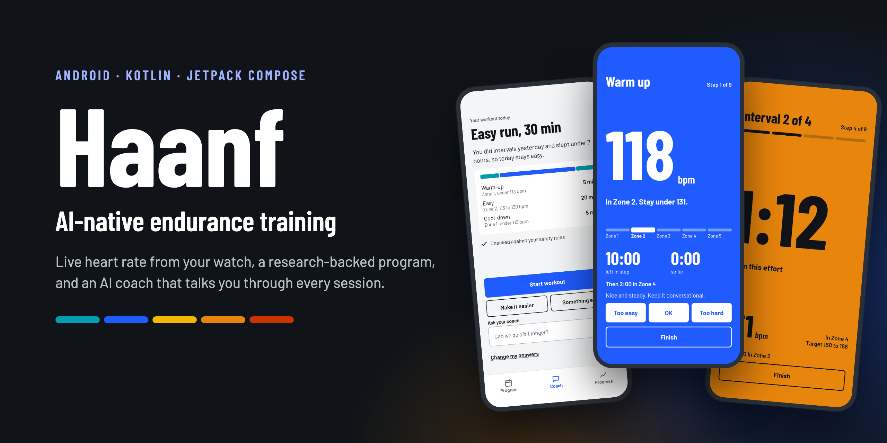
</p>

<p align="center">
  <a href="https://cgrkz.github.io/haanf/"><b>Project page</b></a> &nbsp;·&nbsp;
  <a href="#screens">Screens</a> &nbsp;·&nbsp;
  <a href="#how-it-works">How it works</a> &nbsp;·&nbsp;
  <a href="#build-and-test">Build and test</a>
</p>

<p align="center">
  
  
  
  
  
  
  
</p>

**Haanf is an Android app for people getting into running and cycling.** It reads live heart rate from a watch over Bluetooth, runs each workout step by step with the phone in a pocket, and pairs a fixed, research-backed program with an AI coach. The coach plans sessions, talks you through them by voice and reviews them afterwards. A separate rule check with no AI in it approves everything the coach proposes, and the coach never changes the program.

Everything stays on the phone. There is no backend and no account, and the AI runs on your own key.

## Highlights

**Live heart rate from a standard watch or strap.** Haanf speaks the Bluetooth Heart Rate Profile, so it works with any device that broadcasts it, including a Pixel Watch 2. It detects dropouts, reconnects on its own, and runs in a foreground service so a workout keeps going with the screen off.

**An AI coach that acts through tools.** During a workout the coach wakes on its own schedule, reads heart rate, pace, gradient and climb, and speaks a short cue in the phone's offline voice. It works through tools rather than free text: `speak`, `adjust_workout`, `record_talk_test`, `heart_rate_overview`. In chat it can look back through your history with `find_workouts` and `open_workouts`, and remembers injuries with `remember_fact` once you confirm.

**Safety rules written in code.** `AiWorkoutRules` checks every AI workout and every change before you see it: at most two hard sessions a week, a warm-up and cool-down around hard work, no hard work on a day you feel rough, no Zone 5 until 12 workouts are logged, and no Zone 5 step over 4 minutes. The coach may make a workout harder only after you ask.

**A fixed, research-backed program.** Foundation 8 runs 8 weeks, 3 sessions a week, and builds to 4 x 4 minute intervals, the format from [Helgerud 2007](https://pubmed.ncbi.nlm.nih.gov/17414804/). Miss 7 days and the week repeats, miss 30 and it restarts. The resets are worked out from saved progress whenever they're needed, so nothing is ever rewritten.

**Five zones from your own heart.** Zones start 60, 70, 80 and 90% of the way from your resting heart rate to your maximum. Resting heart rate comes from Health Connect, and every zone can be edited in Settings.

**A talk test, for the effort you can still speak at.** The coach asks whether you could talk comfortably, and you answer by voice, transcribed on the phone, or with a tap. Each answer is saved with your heart rate, which builds the data for a personal talking threshold.

**Terrain-aware rides and runs.** Distance and speed come from GPS, and climb from the barometer. Rides get estimated watts for your bike, and every kilometre gets a split. No coordinates are ever stored.

**Vitals from Health Connect.** Resting heart rate, HRV and sleep trends, read only. Haanf never writes to Health Connect.

<a id="screens"></a>
## Screens

Built screens on the emulator, with sample data.

<table>
  <tr>
    <td align="center" width="25%">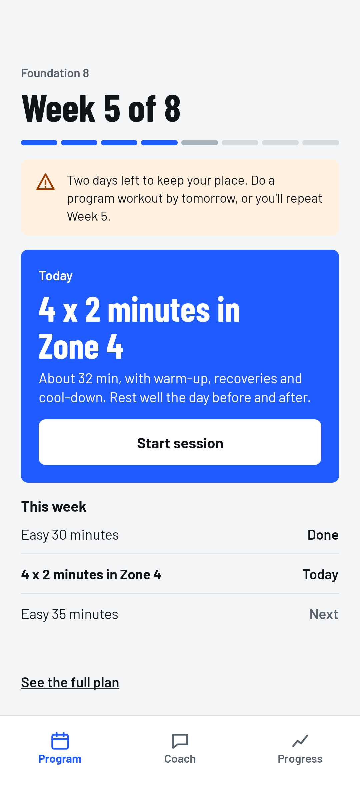<br><sub><b>Program</b><br>Today's session in Foundation 8</sub></td>
    <td align="center" width="25%">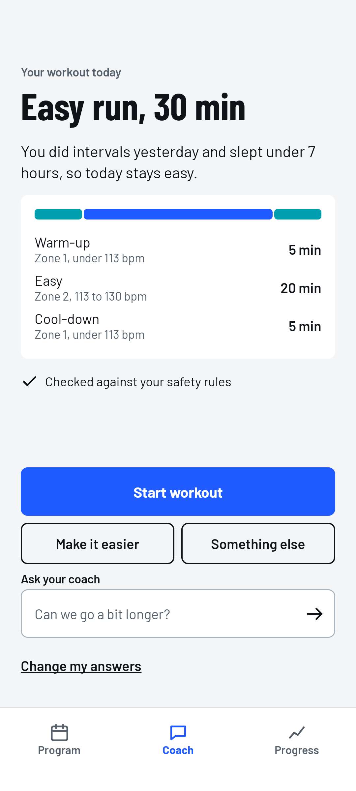<br><sub><b>Coach</b><br>A workout planned from your check-in</sub></td>
    <td align="center" width="25%">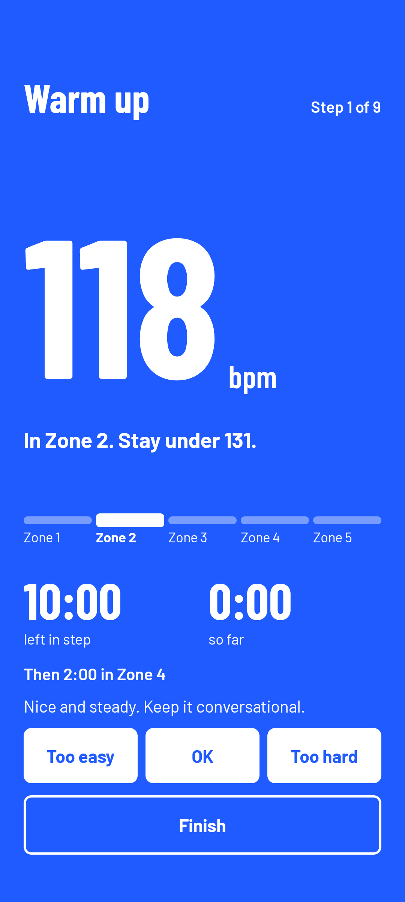<br><sub><b>Live</b><br>Heart rate, zone and what's next</sub></td>
    <td align="center" width="25%">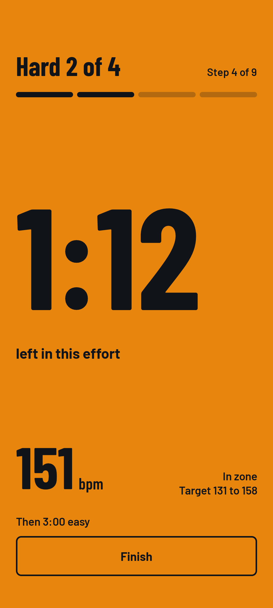<br><sub><b>Intervals</b><br>Time left in the effort</sub></td>
  </tr>
  <tr>
    <td align="center">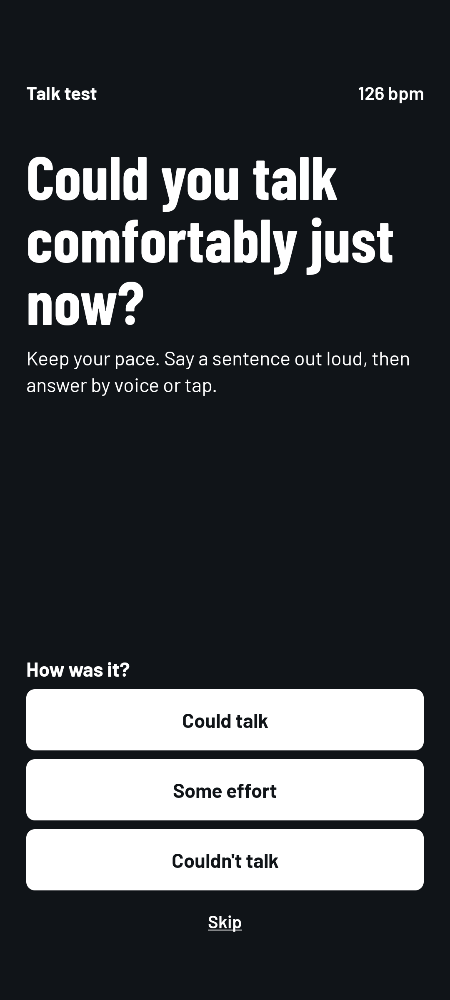<br><sub><b>Talk test</b><br>Answer by voice or tap</sub></td>
    <td align="center">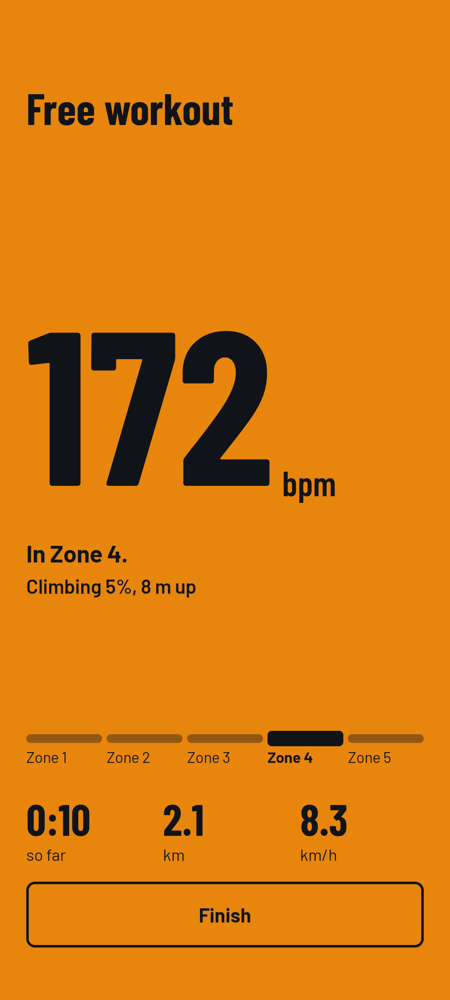<br><sub><b>Rides</b><br>Gradient and climb from the barometer</sub></td>
    <td align="center">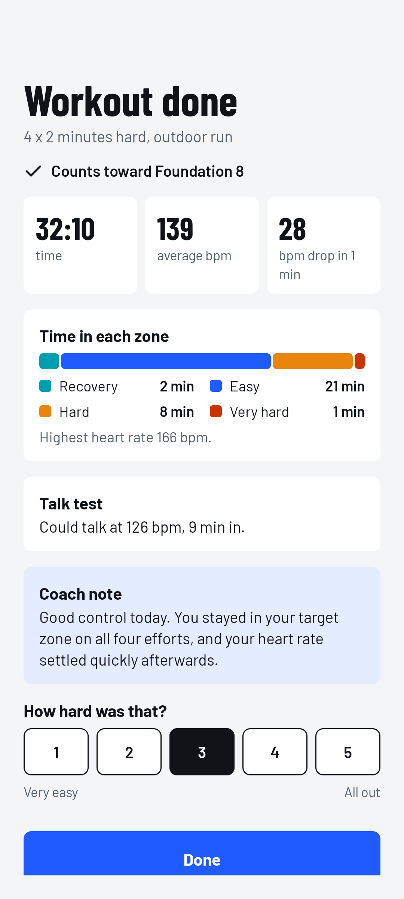<br><sub><b>Summary</b><br>Time in zones and the coach's note</sub></td>
    <td align="center">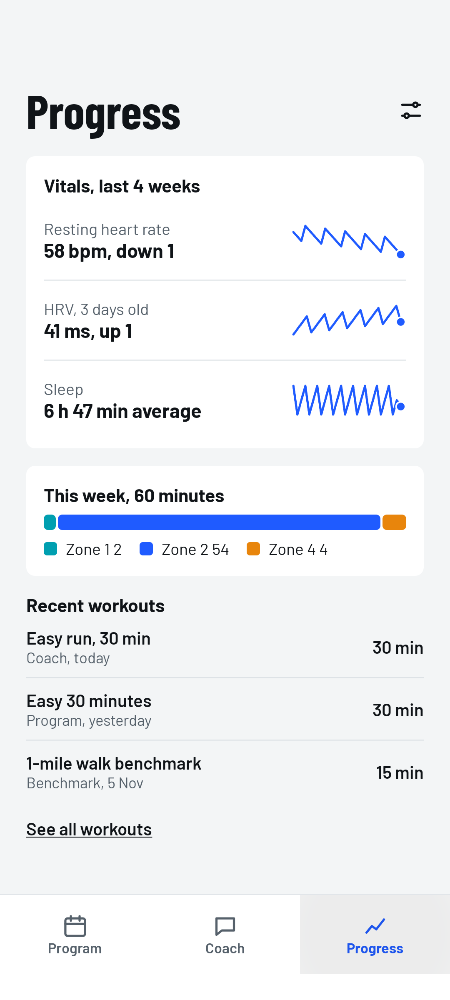<br><sub><b>Progress</b><br>Vitals and the week in zones</sub></td>
  </tr>
  <tr>
    <td align="center">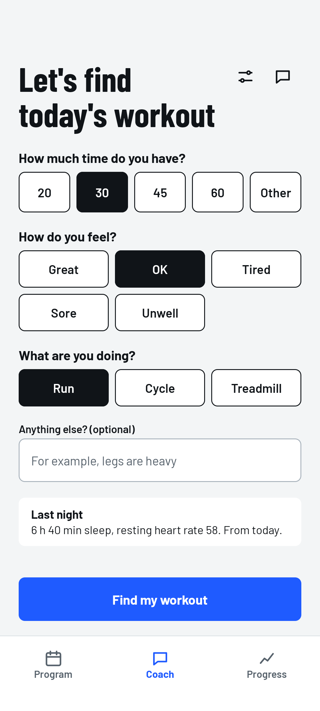<br><sub><b>Check-in</b><br>Time, feel and activity</sub></td>
    <td align="center">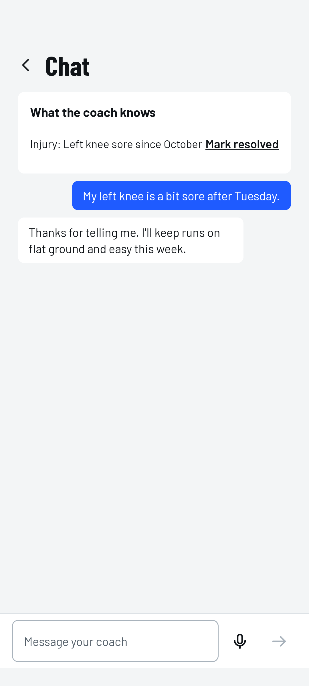<br><sub><b>Chat</b><br>Remembers what matters</sub></td>
    <td align="center">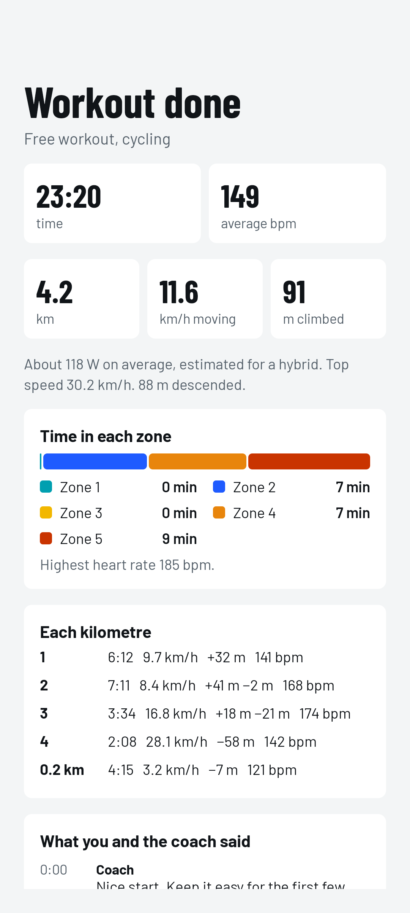<br><sub><b>Ride summary</b><br>Watts, climb and splits</sub></td>
    <td align="center">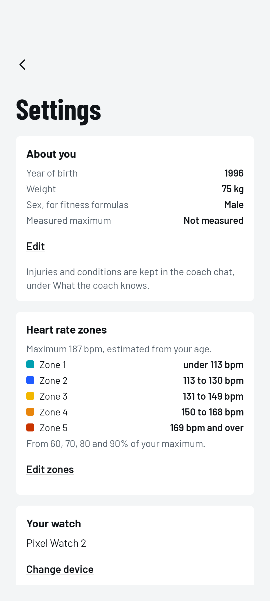<br><sub><b>Settings</b><br>Zones from resting heart rate</sub></td>
  </tr>
</table>

<a id="how-it-works"></a>
## How it works

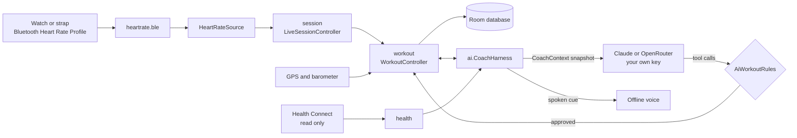

- **One boundary per device.** `HeartRateSource` is the only thing workout logic knows about a wearable. A new watch means a new source, not a change to sessions or workouts.
- **Workouts run outside the screens.** `WorkoutController` owns the steps, timers and speech, so a session survives the screen turning off and the app going to the background.
- **The AI sees only what `CoachContext` gives it.** The snapshot has no field for audio, location or device details, so they can't leak into a prompt by accident.
- **Training logic is plain Kotlin.** Zones, plans, summaries, safety, terrain and effort live in `training` with no Android types, and are tested on the JVM.

## Privacy by design

- No backend and no accounts. Data leaves the phone only when you tap export, or goes to the AI provider you chose, with your key.
- API keys are encrypted with the Android Keystore. They are never in the APK, in git or in backups, and backups are off.
- The app never declares a Health Connect write permission, and network access is limited to the AI providers. `ManifestPolicyTest` fails the build if either changes.
- GPS gives distance and speed only, and the barometer measures climb from the start, never height above sea level.

## Engineering

- **Kotlin and Jetpack Compose,** with hand-written wiring in a single `AppContainer` and no DI framework.
- **Room with 8 schema versions,** each with a migration tested in `MigrationTest`. One of them recounts every saved workout's time in zones from its raw heart rate samples.
- **372 tests:** 313 on the JVM and 59 instrumented, including screenshot tests that capture every designed screen with sample data, to compare with the designs.
- **Simulated Bluetooth peripherals** in Python with [Bumble](https://github.com/google/bumble) exercise the real GATT code on the emulator, including failures that are hard to stage with a real watch. See [`tools/ble-sim`](tools/ble-sim).
- **Live model tests** run the coach against real models with made-up data, behind a switch.
- **A Wear OS probe** (`:wearprobe`) maps what Health Services offers on a watch, to decide what a future watch app could read.

| Area | Used |
| --- | --- |
| Language and UI | Kotlin, Jetpack Compose, Material 3 |
| Storage | Room, with exported schemas and migration tests. Kotlin serialization for AI messages |
| Concurrency | Kotlin coroutines and Flow |
| Sensors | Bluetooth LE GATT, Android location (GPS), barometer |
| Health | Health Connect, read only |
| AI | Anthropic Java SDK with tool use and prompt caching, OpenRouter over OkHttp |
| Voice | Android text to speech, on-device speech recognition |
| Testing | JUnit, Compose UI tests, Room migration tests, a local fake HTTP server, Bumble |

<a id="build-and-test"></a>
## Build and test

Needs JDK 17 or newer and the Android SDK (platform 37, build-tools 36). Gradle comes from the wrapper.

```bash
./gradlew :app:assembleDebug        # APK at app/build/outputs/apk/debug/app-debug.apk
./gradlew :app:testDebugUnitTest    # JVM tests
```

The AI coach needs your own Claude or OpenRouter key, entered in the app. Everything else works without one.

## Status and docs

Haanf is a personal project in Phase 1, the offline training loop. Live heart rate and Health Connect were proven on a real Pixel 6 with a Pixel Watch 2. The docs record each decision, and what was tested on real hardware and what wasn't.

- [Product brief](docs/product-brief.md)
- [Phase 1 plan](docs/phase-1-plan.md), including the zones and program rules
- [AI coach spec](docs/ai-mode-spec.md), including the rule check
- [Technical decisions](docs/decisions.md)
- [Phase 0 results](docs/phase-0-results.md), from real hardware
- [Design notes](docs/design/README.md)

## Author

Built by [Chaitanya Gupta](https://github.com/cgrkz).

All rights reserved. The code is public to read, so please ask before reusing it. The bundled Barlow fonts are under the SIL Open Font License 1.1.
